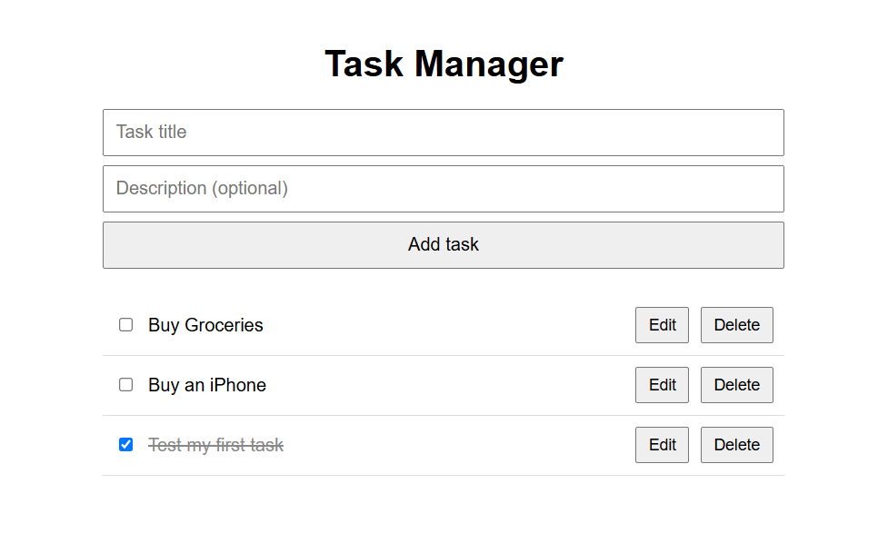

# Task Manager

A full-stack task manager built with Django and Django REST Framework.
Users can add, view, edit, complete, and delete tasks from the browser.

## Features

- Create tasks with a title and optional description
- Mark tasks as complete or incomplete
- Edit task titles inline
- Delete tasks
- REST API with full CRUD support

## Tech Stack

- **Backend:** Python, Django, Django REST Framework
- **Database:** SQLite
- **Frontend:** HTML, CSS, vanilla JavaScript (Fetch API)

## API Endpoints

| Method | Endpoint | Description |
|---|---|---|
| GET | `/api/tasks/` | List all tasks |
| POST | `/api/tasks/` | Create a task |
| GET | `/api/tasks/<id>/` | Get one task |
| PATCH | `/api/tasks/<id>/` | Update a task |
| DELETE | `/api/tasks/<id>/` | Delete a task |

## Run Locally

1. Clone the repository:
   `git clone https://github.com/saintcarloacutis/task-manager.git`
2. Go into the folder and create a virtual environment:
   `python -m venv venv`
3. Activate it (Windows): `venv\Scripts\activate`
4. Install dependencies: `pip install -r requirements.txt`
5. Set up the database: `python manage.py migrate`
6. Start the server: `python manage.py runserver`
7. Open `http://127.0.0.1:8000/`

## What I Learned

- Building a REST API with serializers and viewsets
- Connecting a JavaScript frontend to a backend with `fetch()`
- Using Git and GitHub for version control